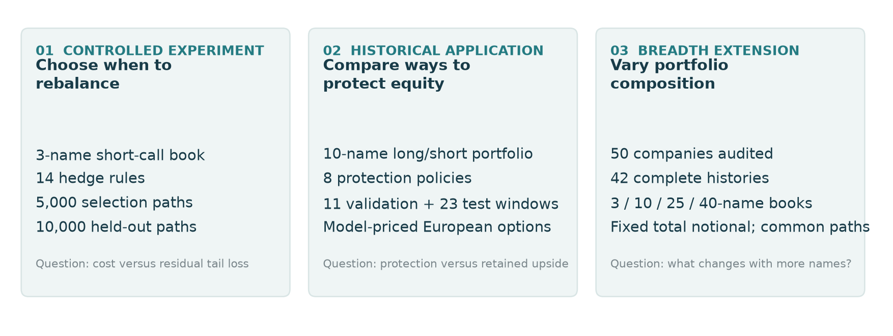
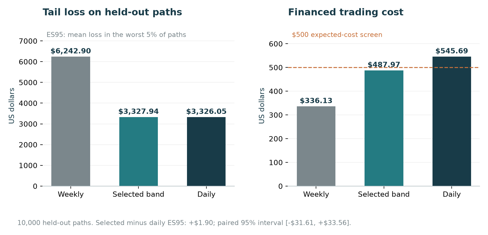
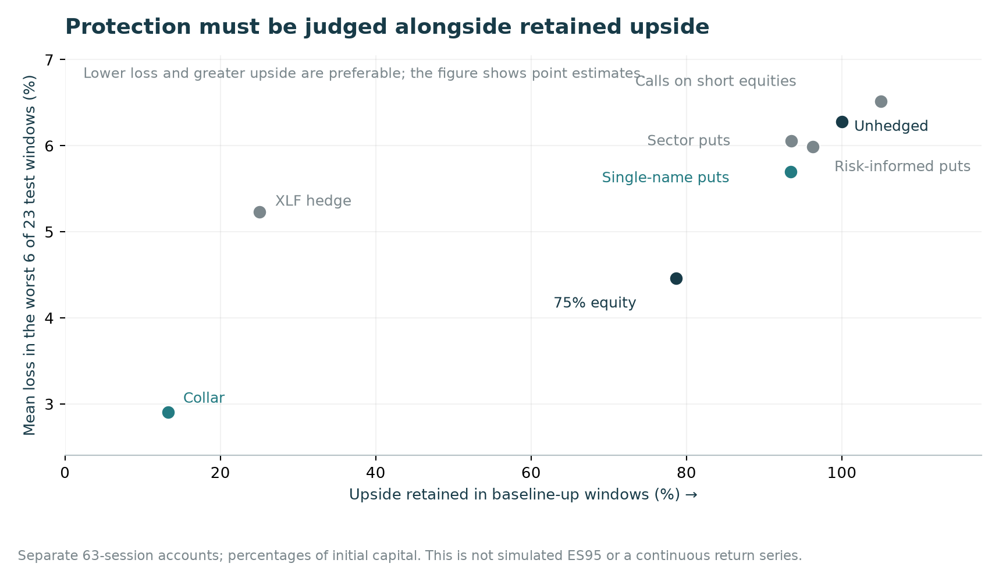
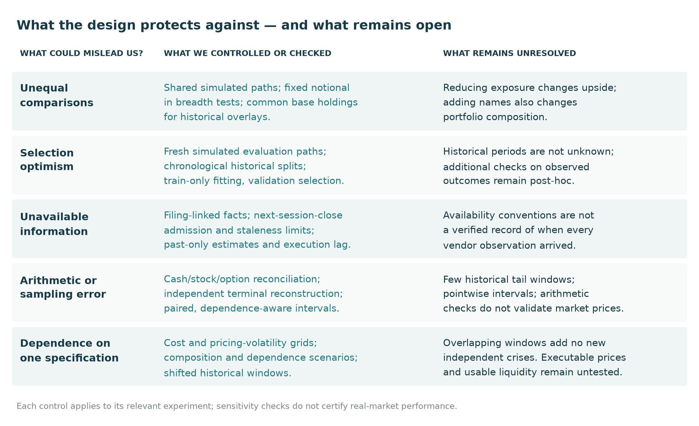

# Monte Carlo option hedging for equity portfolios

*A study of trading costs and downside protection, with a long/short financial-sector equity application.*

**Author: Sai Reddivari**

When does hedging add value beyond simply holding less risk?

The study starts with a controlled Monte Carlo experiment: choose a delta-hedging rule that limits tail losses without spending too much on rebalancing. It then examines a different use of options—protecting a long/short equity portfolio—using financial-sector stocks as the application. Forecasting and portfolio-breadth extensions test whether better information or more names strengthen the case for protection.



These experiments answer related questions. The historical application is not a validation of the simulated rule, and the financial-statement forecasts were not connected to an end-to-end hedge strategy.

## Monte Carlo identifies a cost–risk tradeoff

Fourteen rebalancing rules compete on 5,000 simulated paths under a $500 expected financed trading-cost screen. The selected maturity-sensitive band is locked before evaluation on 10,000 new paths.

**The selected rule reduces ES95 by 46.7% relative to weekly hedging, at higher trading cost.** Against daily hedging, it costs **10.6% less**, while the ES95 difference is inconclusive: +$1.90, with a paired 95% interval of −$31.61 to +$33.56. That supports a conditional cost–risk tradeoff; it does not establish equivalence to daily hedging.



ES95 is mean loss in the worst 5% of simulated outcomes. The three-name short-call book has $300,000 initial underlying notional. Rates, volatilities and correlations are illustrative. The $500 screen constrains the upper confidence endpoint for expected cost, not every path’s spending.

## Protecting equity introduces a second price: surrendered upside

The historical application holds ten financial-sector companies in a fixed long/short mandate. Eight policies—two baselines and six hedge families—are compared over separate 63-session accounts, with 11 validation windows and 23 test windows. The decision-close targets are 90% long and 40% short equity. Options are model-priced European contracts; no historical option quotes were acquired.

**Reducing equity is a demanding benchmark.** Single-name puts retain more upside than a 75%-sized equity book, but their estimated tail loss is higher. The collar has a lower tail-loss estimate and retains only 13.2% of upside. Its exposure changes substantially; the study does not establish that the entire benefit is caused by that change.



Here, tail loss means the average loss in the worst six of 23 test windows—not the simulation’s ES95. These are point estimates. Purchased-put differences from the unhedged portfolio are inconclusive under the reported intervals; the collar’s incremental tail advantage over reduced equity is also unresolved.

The Black–Scholes pricing assumption omits observed bid/ask, dividends, borrow spreads, margin and American exercise. The accounts are separate windows, not a continuous investment history. **Incremental economic hedge value remains unestablished.**

## How the comparisons were constructed

The design tries to separate the effect of a hedge from differences in the paths, holdings or information used to evaluate it. Simulated policies share paths; breadth experiments hold total notional fixed; historical overlays share executed base holdings. Selection and evaluation are separated, while filing-aware features and lagged execution restrict what a decision can use.



These are different kinds of safeguards. Accounting reconstruction checks implementation; paired and dependence-aware intervals quantify sampling uncertainty; sensitivity runs show how conclusions change with assumptions. Budget treatment also differs: simulation enforces an expected-cost screen, while historical premium allowances size trades at the decision close. Execution-time premium caps were **not** enforced; overruns remain in the results.

## What the extensions add

The expanded universe covers **50 current companies: 42 complete histories and eight partial histories**. Fixed-notional simulations compare portfolios of **3, 10, 25 and 40 names**. More names do not always lower tail risk when composition and common exposures change. This is a breadth experiment, not a 40-name historical overlay backtest. Current-survivor coverage does not establish historical sector membership.

The forecasting extension asks whether a company's balance sheet adds information beyond its price history and broad market/sector conditions. Liabilities/assets measures the share of assets funded by liabilities; deposits/liabilities measures the share of a bank's liabilities supplied by deposits. Neither is a complete measure of funding vulnerability. SPY/XLF inputs provide the market/sector benchmark those features must improve on. SEC observations are linked to filings, admitted conservatively from the next session's close and subject to release- and fiscal-period staleness limits. Transformations are fitted on training data, and validation selects regularization before test evaluation.

The targets are five- and twenty-session variance. Price-history improvements depend on metric and horizon. Liabilities/assets adds a small five-session improvement across ten companies; deposits/liabilities worsens incremental QLIKE for the six-bank cohort. That result concerns the tested proxy and model, not funding risk in general. Forecast accuracy is evaluated separately from hedge performance: these financial-statement models did not drive the historical adaptive overlay.

The next questions are practical: which portfolio loss should be insured, what real option quotes imply for affordable coverage, whether interim protection can be monetized, and whether staggered expiries or adaptive coverage improve the tradeoff. The paper develops these questions alongside the evidence that motivates them.

Read the **[research study](docs/research_study.pdf)** or its [LaTeX source](docs/latex/research_study.tex). [Technical notes](docs/technical_notes.md) define the metrics and record display corrections. [Notebooks](notebooks/) show the experiment steps.

## Reproduce

Use Python 3.14.8, the pinned dependencies, and a clone containing the `pre-refactor` tag.

```sh
python3.14 -m venv .venv
.venv/bin/python -m pip install -r requirements.lock
make figures       # Rebuild figures from saved aggregate tables
make test          # Tests, including a three-experiment numerical regression
make reproduce     # Eight research variants, notebooks and independent validation
make diff          # Compare full-precision results with the saved baseline
```

The [reproduction guide](docs/REPRODUCTION.md) explains inputs, commands and limitations. Full reproduction restores exact historical inputs from the tag; live vendor queries are not equivalent. The [data guide](data/README.md) records provenance and access restrictions. Building the figures does not fit models, run simulations or acquire data.

`src/` contains implementation and runners; `notebooks/` the worked studies; `tests/` validation; `config/` experiment settings; `data/` input documentation; `results/` canonical evidence; and `docs/` the paper and supporting material.

Use [CITATION.cff](CITATION.cff) to cite the study. [LICENSE](LICENSE) covers the software, not third-party market data. The work was directed by Sai Reddivari with AI assistance in implementation, testing and editing.
