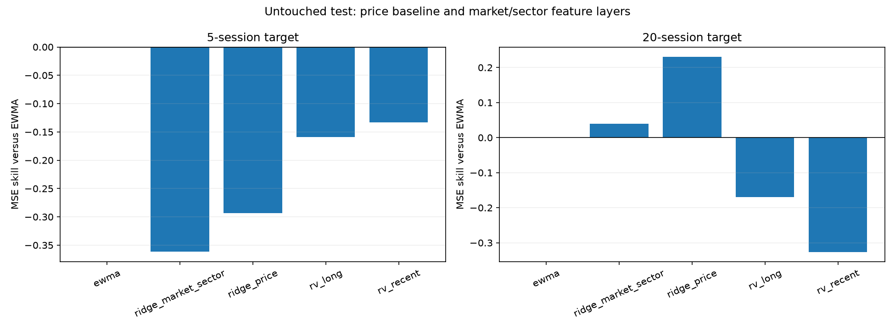
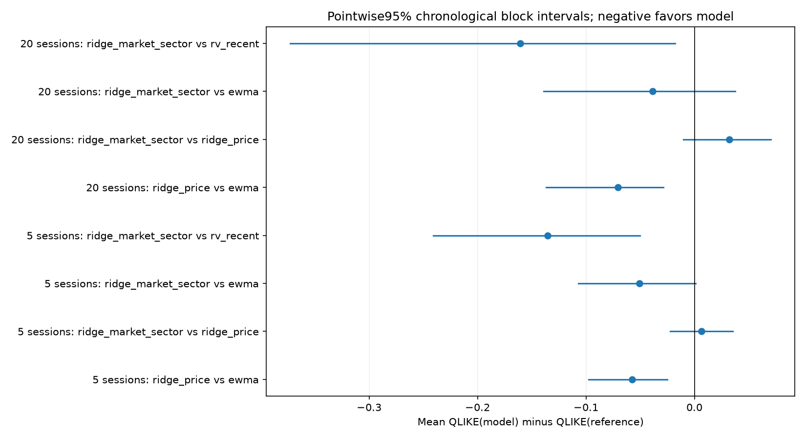

# Release-aware incremental feature research

Actual sample: JPM, PNC, GS, BAC, WFC, C, USB, MS, SCHW, BK, with observed SPY/XLF features. 4,236 aligned sessions through 2026-11-04.

## Frozen design and timing

Training 2010–2017; validation 2018–2020; test 2021–2026-11-04. Targets are total underlying cumulative next 5/20-session squared log returns. Windows are disjoint within each split/horizon. Features use information through the origin close; forecasts are issued after close, so derivative execution cannot assume those final-close features were known before a same-close fill.

Direct benchmarks: rolling 20/252-session variance and EWMA(lambda 0.94). Interpretable ridge forecasts log daily variance; a training-only residual smearing correction back-transforms to positive expected variance, multiplied by the horizon. The price layer uses own past variance/momentum and issuer intercepts; the incremental market/sector layer adds actual SPY/XLF risk/return features and past-only factor betas/interactions.

All scalers, coefficients, smearing factors and numerical prediction bounds are fit on training rows only. A fixed ridge grid 0.1/1/10/100/1000 is compared on validation QLIKE; the chosen models are persisted and hashed before test predictions. No test outcome chooses the model or alpha, and there is no train+validation refit. Full training/validationtarget intervals stop at their respective split boundaries.

## Feature admission audit

Company fields observed: 907; strictly admissible fields: 0. Treasury observations: 123; strictly admissible observations: 0.

Current standardized financial values with accepted dates do not establish original-filing vintages; the as-reported samples lack publication timestamps. Treasury data have only bounded 2019/2020samples and an explicitly assumed lag rather than measured historical publication/vintage availability. Neither layer enters the model. Fiscal period ends are never treated as release dates; unknown financials are never filled with zero. The implemented strict asofjoin remains ready for verified original-vintage observations.

## Selected models

| horizon | model | alpha | validation_mean_qlike | train_rows | training_latest_target | validation_latest_target |
| --- | --- | --- | --- | --- | --- | --- |
| 5 | ridge_price | 100 | -5.33111 | 3520 | 2017-12-29 00:00:00 | 2020-12-31 00:00:00 |
| 5 | ridge_market_sector | 10 | -5.33305 | 3520 | 2017-12-29 00:00:00 | 2020-12-31 00:00:00 |
| 20 | ridge_price | 0.1 | -3.52978 | 880 | 2017-12-29 00:00:00 | 2020-12-09 00:00:00 |
| 20 | ridge_market_sector | 0.1 | -3.52642 | 880 | 2017-12-29 00:00:00 | 2020-12-09 00:00:00 |

## Untouched test scores

| split | horizon | model | n_dates | n_asset_forecasts | mean_qlike | mean_mse | mse_skill_vs_ewma | qlike_difference_vs_ewma |
| --- | --- | --- | --- | --- | --- | --- | --- | --- |
| test | 5 | ewma | 293 | 2930 | -5.44718 | 4.6778e-06 | 0 | 0 |
| test | 5 | ridge_market_sector | 293 | 2930 | -5.49788 | 6.36806e-06 | -0.361337 | -0.0507012 |
| test | 5 | ridge_price | 293 | 2930 | -5.50451 | 6.04983e-06 | -0.293308 | -0.0573297 |
| test | 5 | rv_long | 293 | 2930 | -5.44112 | 5.42344e-06 | -0.1594 | 0.00605881 |
| test | 5 | rv_recent | 293 | 2930 | -5.36265 | 5.30041e-06 | -0.133099 | 0.0845336 |
| test | 20 | ewma | 73 | 730 | -4.01922 | 4.03386e-05 | 0 | 0 |
| test | 20 | ridge_market_sector | 73 | 730 | -4.05776 | 3.87573e-05 | 0.039199 | -0.0385463 |
| test | 20 | ridge_price | 73 | 730 | -4.08989 | 3.10327e-05 | 0.230693 | -0.0706677 |
| test | 20 | rv_long | 73 | 730 | -4.04267 | 4.71879e-05 | -0.169796 | -0.0234514 |
| test | 20 | rv_recent | 73 | 730 | -3.89708 | 5.35074e-05 | -0.326459 | 0.12214 |

QLIKE is log(forecast)+realized/forecast, omitting a target-only constant; lower is better. MSE skill above zero improves on EWMA. These are forecasts of physical stock-return risk, not option-implied volatilities or Q prices.

## Incremental information and uncertainty

| horizon | left_model | reference | estimate | lower | upper | n_dates | block_length |
| --- | --- | --- | --- | --- | --- | --- | --- |
| 5 | ridge_price | ewma | -0.0573297 | -0.0974167 | -0.0248898 | 293 | 13 |
| 5 | ridge_market_sector | ridge_price | 0.00662847 | -0.022246 | 0.0353873 | 293 | 13 |
| 5 | ridge_market_sector | ewma | -0.0507012 | -0.107151 | 0.000957912 | 293 | 13 |
| 5 | ridge_market_sector | rv_recent | -0.135235 | -0.240807 | -0.050321 | 293 | 13 |
| 20 | ridge_price | ewma | -0.0706677 | -0.136605 | -0.0284938 | 73 | 4 |
| 20 | ridge_market_sector | ridge_price | 0.0321215 | -0.0102628 | 0.0706155 | 73 | 4 |
| 20 | ridge_market_sector | ewma | -0.0385463 | -0.138977 | 0.0374445 | 73 | 4 |
| 20 | ridge_market_sector | rv_recent | -0.160686 | -0.372769 | -0.0176358 | 73 | 4 |

Loss differences average across companies at each date before circular moving-block resampling, keeping common market episodes together. Quarter-length chronological blocks address residual temporal dependence. These are pointwise 95% intervals, not simultaneous model dominance or a count of independent crises across stocks. Validation intervals are selection diagnostics; final performance interpretation uses test intervals.

## Gates and limitations

This artifact completes a controlled incremental test of observed market/sector price information over own-price baselines. Negative or inconclusive findings are retained. The funding/macro feature gate remains open because strict availability/vintage coverage did not pass. Forecast-to-hedge value is not inferred from forecast scores and still requires a properly timed overlay experiment.

The universe is conditioned on currently available names, not verified historical membership. Split-adjusted price returns exclude dividend cash flows; latest vendor histories do not certify every historical revision. These limitations prevent a full stage 7 or listed-option profitability claim.

## Provenance

protocol.json records the frozen hypotheses, features, ridge grid, inputs and rejected feature audit. selected_models.json records training-only scaling/coefficients and validation selection before test predictions. CSVs contain per-company scores, every prediction and dependence-aware differences. manifest.json hashes all inputs/source/output artifacts. No credentials are read or recorded.
