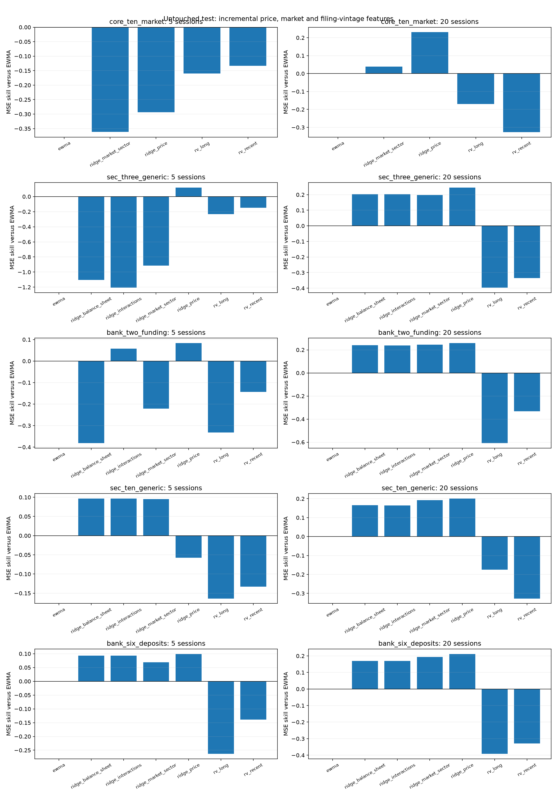
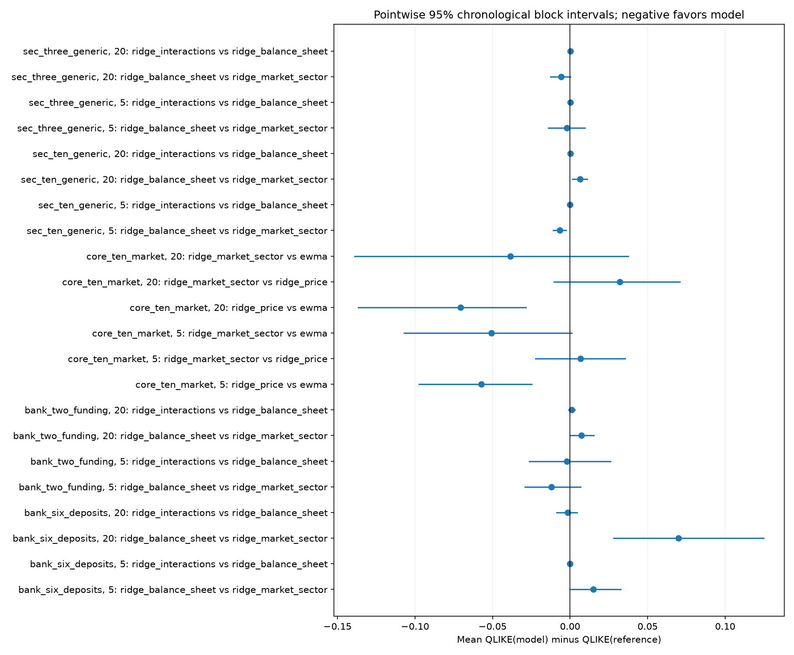

# Release-aware incremental feature research

Actual core sample: JPM, PNC, GS, BAC, WFC, C, USB, MS, SCHW, BK, observed SPY/XLF features and audited official SEC filing facts for JPM/PNC/GS. 4,236 aligned stock sessions through 2026-11-04.

## Frozen design and timing

Training 2010–2017; validation 2018–2020; test 2021–2026-11-04. Targets are TOTAL underlying cumulative next-5/20-session squared log returns, not residual variance. Windows are disjoint within each split/horizon. Features use information through the origin close; forecasts are issued after close, so derivative execution cannot assume final-close features were known before a same-close fill.

Direct benchmarks are rolling 20/252-session variance and EWMA(lambda 0.94). Ridge forecasts log daily variance; training-only residual smearing back-transforms to positive expected variance, multiplied by the horizon. All scalers, coefficients, smearing factors and numerical prediction bounds are fit on training rows only. A fixed alpha grid 0.1/1/10/100/1000 is selected on validation QLIKE. Selected models are persisted and hashed before test predictions; there is no train+validation refit or test-based model selection.

## Matched cohorts and economic hypotheses

| cohort | assets | input_asset_origin_rows | eligible_nonoverlap_rows | test_5_session_origins | test_20_session_origins | latest_test_origin | latest_test_target |
| --- | --- | --- | --- | --- | --- | --- | --- |
| core_ten_market | JPM,PNC,GS,BAC,WFC,C,USB,MS,SCHW,BK | 79430 | 9940 | 293 | 73 | 2026-10-27 00:00:00 | 2026-11-03 00:00:00 |
| sec_three_generic | JPM,PNC,GS | 23829 | 2982 | 293 | 73 | 2026-10-27 00:00:00 | 2026-11-03 00:00:00 |
| bank_two_funding | JPM,PNC | 15886 | 1988 | 293 | 73 | 2026-10-27 00:00:00 | 2026-11-03 00:00:00 |
| sec_ten_generic | JPM,PNC,GS,BAC,WFC,C,USB,MS,SCHW,BK | 79430 | 9510 | 276 | 69 | 2026-06-26 00:00:00 | 2026-07-06 00:00:00 |
| bank_six_deposits | JPM,PNC,BAC,WFC,C,USB | 47658 | 5706 | 276 | 69 | 2026-06-26 00:00:00 | 2026-07-06 00:00:00 |

Core-ten tests own-price information against added observed SPY/XLF risk, return and past-only beta features. SEC-three compares this market baseline with generic published liabilities/assets, then its interaction with the five-session XLF return. Bank-two compares market information with deposits/liabilities and cash-due-from-banks/assets, then their XLF-return interactions. The optional separate core-ten generic and six-bank deposit extension retains the same splits/grid; it excludes missing/stale financial rows on a matched-sample basis. GS is excluded from the bank-deposit hypothesis. These are accounting exposure proxies, not regulatory capital, LCR or insured-deposit measures.

Every comparison inside a cohort uses the same fully observed names/dates. Missing fundamentals are never zero-filled. PNC has no CashEq history, so the bank liquidity proxy consistently uses the distinct CashAndDueFromBanks concept for both banks; cash-equivalent fields are not silently substituted.

## Release and vintage admission

Unverified FMP company-field snapshots observed: 907; Treasury observations: 123. Neither current-restated FMP values nor the limited date-only Treasury samples enters the model.

Official SEC companyfacts bind instant USD facts to accession and filed date. Recent submission metadata independently crosschecks a subset; older facts retain native SEC binding rather than an independent archive download. Ratios require the same filing and fiscal period. Availability is a conservative next-XNYS-session-close bound after the actual filed DATE, not a measured acceptance timestamp. Releases accepted after the origin cutoff cannot enter that origin. As-of logic selects the newest available fiscal period and then its latest available revision; a later comparative/amendment of an older period cannot roll back a newer known quarter. Both release age and fiscal-period age are bounded at180calendar days. A recent comparative republication cannot refresh an old fiscal period; Citi2025Q4 and latermissingcoverage are explicitly excluded when stale rather than treated as current.

## Validation-selected model settings

| cohort | horizon | model | alpha | validation_mean_qlike | train_rows | training_latest_target | validation_latest_target |
| --- | --- | --- | --- | --- | --- | --- | --- |
| core_ten_market | 5 | ridge_price | 100 | -5.33111 | 3520 | 2017-12-29 00:00:00 | 2020-12-31 00:00:00 |
| core_ten_market | 5 | ridge_market_sector | 10 | -5.33305 | 3520 | 2017-12-29 00:00:00 | 2020-12-31 00:00:00 |
| core_ten_market | 20 | ridge_price | 0.1 | -3.52978 | 880 | 2017-12-29 00:00:00 | 2020-12-09 00:00:00 |
| core_ten_market | 20 | ridge_market_sector | 0.1 | -3.52642 | 880 | 2017-12-29 00:00:00 | 2020-12-09 00:00:00 |
| sec_three_generic | 5 | ridge_price | 10 | -5.44218 | 1056 | 2017-12-29 00:00:00 | 2020-12-31 00:00:00 |
| sec_three_generic | 5 | ridge_market_sector | 1 | -5.4475 | 1056 | 2017-12-29 00:00:00 | 2020-12-31 00:00:00 |
| sec_three_generic | 5 | ridge_balance_sheet | 1 | -5.44856 | 1056 | 2017-12-29 00:00:00 | 2020-12-31 00:00:00 |
| sec_three_generic | 5 | ridge_interactions | 1 | -5.44944 | 1056 | 2017-12-29 00:00:00 | 2020-12-31 00:00:00 |
| sec_three_generic | 20 | ridge_price | 0.1 | -3.57175 | 264 | 2017-12-29 00:00:00 | 2020-12-09 00:00:00 |
| sec_three_generic | 20 | ridge_market_sector | 100 | -3.55912 | 264 | 2017-12-29 00:00:00 | 2020-12-09 00:00:00 |
| sec_three_generic | 20 | ridge_balance_sheet | 100 | -3.56047 | 264 | 2017-12-29 00:00:00 | 2020-12-09 00:00:00 |
| sec_three_generic | 20 | ridge_interactions | 100 | -3.56106 | 264 | 2017-12-29 00:00:00 | 2020-12-09 00:00:00 |
| bank_two_funding | 5 | ridge_price | 10 | -5.47549 | 704 | 2017-12-29 00:00:00 | 2020-12-31 00:00:00 |
| bank_two_funding | 5 | ridge_market_sector | 10 | -5.46682 | 704 | 2017-12-29 00:00:00 | 2020-12-31 00:00:00 |
| bank_two_funding | 5 | ridge_balance_sheet | 1 | -5.45239 | 704 | 2017-12-29 00:00:00 | 2020-12-31 00:00:00 |
| bank_two_funding | 5 | ridge_interactions | 10 | -5.44746 | 704 | 2017-12-29 00:00:00 | 2020-12-31 00:00:00 |
| bank_two_funding | 20 | ridge_price | 0.1 | -3.59396 | 176 | 2017-12-29 00:00:00 | 2020-12-09 00:00:00 |
| bank_two_funding | 20 | ridge_market_sector | 100 | -3.53409 | 176 | 2017-12-29 00:00:00 | 2020-12-09 00:00:00 |
| bank_two_funding | 20 | ridge_balance_sheet | 100 | -3.51162 | 176 | 2017-12-29 00:00:00 | 2020-12-09 00:00:00 |
| bank_two_funding | 20 | ridge_interactions | 100 | -3.49033 | 176 | 2017-12-29 00:00:00 | 2020-12-09 00:00:00 |
| sec_ten_generic | 5 | ridge_price | 0.1 | -5.30444 | 3340 | 2017-12-27 00:00:00 | 2020-12-31 00:00:00 |
| sec_ten_generic | 5 | ridge_market_sector | 1000 | -5.28051 | 3340 | 2017-12-27 00:00:00 | 2020-12-31 00:00:00 |
| sec_ten_generic | 5 | ridge_balance_sheet | 1000 | -5.28281 | 3340 | 2017-12-27 00:00:00 | 2020-12-31 00:00:00 |
| sec_ten_generic | 5 | ridge_interactions | 1000 | -5.28277 | 3340 | 2017-12-27 00:00:00 | 2020-12-31 00:00:00 |
| sec_ten_generic | 20 | ridge_price | 0.1 | -3.52659 | 840 | 2017-12-19 00:00:00 | 2020-12-09 00:00:00 |
| sec_ten_generic | 20 | ridge_market_sector | 0.1 | -3.62238 | 840 | 2017-12-19 00:00:00 | 2020-12-09 00:00:00 |
| sec_ten_generic | 20 | ridge_balance_sheet | 0.1 | -3.62475 | 840 | 2017-12-19 00:00:00 | 2020-12-09 00:00:00 |
| sec_ten_generic | 20 | ridge_interactions | 0.1 | -3.62533 | 840 | 2017-12-19 00:00:00 | 2020-12-09 00:00:00 |
| bank_six_deposits | 5 | ridge_price | 0.1 | -5.3475 | 2004 | 2017-12-27 00:00:00 | 2020-12-31 00:00:00 |
| bank_six_deposits | 5 | ridge_market_sector | 1 | -5.29597 | 2004 | 2017-12-27 00:00:00 | 2020-12-31 00:00:00 |
| bank_six_deposits | 5 | ridge_balance_sheet | 100 | -5.27593 | 2004 | 2017-12-27 00:00:00 | 2020-12-31 00:00:00 |
| bank_six_deposits | 5 | ridge_interactions | 100 | -5.27586 | 2004 | 2017-12-27 00:00:00 | 2020-12-31 00:00:00 |
| bank_six_deposits | 20 | ridge_price | 0.1 | -3.44994 | 504 | 2017-12-19 00:00:00 | 2020-12-09 00:00:00 |
| bank_six_deposits | 20 | ridge_market_sector | 0.1 | -3.56951 | 504 | 2017-12-19 00:00:00 | 2020-12-09 00:00:00 |
| bank_six_deposits | 20 | ridge_balance_sheet | 0.1 | -3.51746 | 504 | 2017-12-19 00:00:00 | 2020-12-09 00:00:00 |
| bank_six_deposits | 20 | ridge_interactions | 0.1 | -3.4966 | 504 | 2017-12-19 00:00:00 | 2020-12-09 00:00:00 |

## Untouched test scores

| cohort | split | horizon | model | n_dates | n_asset_forecasts | mean_qlike | mean_mse | mse_skill_vs_ewma | qlike_difference_vs_ewma |
| --- | --- | --- | --- | --- | --- | --- | --- | --- | --- |
| bank_six_deposits | test | 5 | ewma | 276 | 1656 | -5.43731 | 4.06557e-06 | 0 | 0 |
| bank_six_deposits | test | 5 | ridge_balance_sheet | 276 | 1656 | -5.46186 | 3.68823e-06 | 0.0928145 | -0.0245493 |
| bank_six_deposits | test | 5 | ridge_interactions | 276 | 1656 | -5.46183 | 3.68746e-06 | 0.0930041 | -0.0245161 |
| bank_six_deposits | test | 5 | ridge_market_sector | 276 | 1656 | -5.47688 | 3.78396e-06 | 0.0692688 | -0.039561 |
| bank_six_deposits | test | 5 | ridge_price | 276 | 1656 | -5.47825 | 3.66365e-06 | 0.0988595 | -0.0409324 |
| bank_six_deposits | test | 5 | rv_long | 276 | 1656 | -5.41825 | 5.13685e-06 | -0.263499 | 0.0190694 |
| bank_six_deposits | test | 5 | rv_recent | 276 | 1656 | -5.35991 | 4.62991e-06 | -0.138808 | 0.0774091 |
| bank_six_deposits | test | 20 | ewma | 69 | 414 | -4.00238 | 3.49193e-05 | 0 | 0 |
| bank_six_deposits | test | 20 | ridge_balance_sheet | 69 | 414 | -3.97072 | 2.89999e-05 | 0.169517 | 0.0316629 |
| bank_six_deposits | test | 20 | ridge_interactions | 69 | 414 | -3.97238 | 2.90072e-05 | 0.169305 | 0.0300042 |
| bank_six_deposits | test | 20 | ridge_market_sector | 69 | 414 | -4.04065 | 2.81613e-05 | 0.193532 | -0.0382721 |
| bank_six_deposits | test | 20 | ridge_price | 69 | 414 | -4.0407 | 2.75378e-05 | 0.211387 | -0.0383218 |
| bank_six_deposits | test | 20 | rv_long | 69 | 414 | -4.02073 | 4.8622e-05 | -0.392412 | -0.0183452 |
| bank_six_deposits | test | 20 | rv_recent | 69 | 414 | -3.88758 | 4.63963e-05 | -0.328675 | 0.114804 |
| bank_two_funding | test | 5 | ewma | 293 | 586 | -5.64608 | 2.3831e-06 | 0 | 0 |
| bank_two_funding | test | 5 | ridge_balance_sheet | 293 | 586 | -5.66921 | 3.29104e-06 | -0.38099 | -0.0231331 |
| bank_two_funding | test | 5 | ridge_interactions | 293 | 586 | -5.6713 | 2.24669e-06 | 0.0572435 | -0.0252271 |
| bank_two_funding | test | 5 | ridge_market_sector | 293 | 586 | -5.6571 | 2.91055e-06 | -0.221328 | -0.0110264 |
| bank_two_funding | test | 5 | ridge_price | 293 | 586 | -5.68268 | 2.18418e-06 | 0.0834714 | -0.0365999 |
| bank_two_funding | test | 5 | rv_long | 293 | 586 | -5.61141 | 3.17361e-06 | -0.331713 | 0.0346666 |
| bank_two_funding | test | 5 | rv_recent | 293 | 586 | -5.57455 | 2.72381e-06 | -0.142969 | 0.0715261 |
| bank_two_funding | test | 20 | ewma | 73 | 146 | -4.22799 | 1.93209e-05 | 0 | 0 |
| bank_two_funding | test | 20 | ridge_balance_sheet | 73 | 146 | -4.2639 | 1.46985e-05 | 0.239241 | -0.0359124 |
| bank_two_funding | test | 20 | ridge_interactions | 73 | 146 | -4.26295 | 1.47322e-05 | 0.237498 | -0.0349613 |
| bank_two_funding | test | 20 | ridge_market_sector | 73 | 146 | -4.27119 | 1.45722e-05 | 0.24578 | -0.0432044 |
| bank_two_funding | test | 20 | ridge_price | 73 | 146 | -4.28117 | 1.43296e-05 | 0.258333 | -0.0531878 |
| bank_two_funding | test | 20 | rv_long | 73 | 146 | -4.21443 | 3.10534e-05 | -0.607247 | 0.0135535 |
| bank_two_funding | test | 20 | rv_recent | 73 | 146 | -4.14563 | 2.57324e-05 | -0.331844 | 0.0823571 |
| core_ten_market | test | 5 | ewma | 293 | 2930 | -5.44718 | 4.6778e-06 | 0 | 0 |
| core_ten_market | test | 5 | ridge_market_sector | 293 | 2930 | -5.49788 | 6.36806e-06 | -0.361337 | -0.0507012 |
| core_ten_market | test | 5 | ridge_price | 293 | 2930 | -5.50451 | 6.04983e-06 | -0.293308 | -0.0573297 |
| core_ten_market | test | 5 | rv_long | 293 | 2930 | -5.44112 | 5.42344e-06 | -0.1594 | 0.00605881 |
| core_ten_market | test | 5 | rv_recent | 293 | 2930 | -5.36265 | 5.30041e-06 | -0.133099 | 0.0845336 |
| core_ten_market | test | 20 | ewma | 73 | 730 | -4.01922 | 4.03386e-05 | 0 | 0 |
| core_ten_market | test | 20 | ridge_market_sector | 73 | 730 | -4.05776 | 3.87573e-05 | 0.039199 | -0.0385463 |
| core_ten_market | test | 20 | ridge_price | 73 | 730 | -4.08989 | 3.10327e-05 | 0.230693 | -0.0706677 |
| core_ten_market | test | 20 | rv_long | 73 | 730 | -4.04267 | 4.71879e-05 | -0.169796 | -0.0234514 |
| core_ten_market | test | 20 | rv_recent | 73 | 730 | -3.89708 | 5.35074e-05 | -0.326459 | 0.12214 |
| sec_ten_generic | test | 5 | ewma | 276 | 2760 | -5.42441 | 4.8768e-06 | 0 | 0 |
| sec_ten_generic | test | 5 | ridge_balance_sheet | 276 | 2760 | -5.47786 | 4.40609e-06 | 0.0965186 | -0.053447 |
| sec_ten_generic | test | 5 | ridge_interactions | 276 | 2760 | -5.4779 | 4.4056e-06 | 0.0966206 | -0.0534897 |
| sec_ten_generic | test | 5 | ridge_market_sector | 276 | 2760 | -5.47126 | 4.41297e-06 | 0.0951084 | -0.0468487 |
| sec_ten_generic | test | 5 | ridge_price | 276 | 2760 | -5.4767 | 5.1586e-06 | -0.0577858 | -0.0522922 |
| sec_ten_generic | test | 5 | rv_long | 276 | 2760 | -5.41533 | 5.67574e-06 | -0.163826 | 0.00907703 |
| sec_ten_generic | test | 5 | rv_recent | 276 | 2760 | -5.33668 | 5.52688e-06 | -0.133301 | 0.0877277 |
| sec_ten_generic | test | 20 | ewma | 69 | 690 | -3.99428 | 4.21111e-05 | 0 | 0 |
| sec_ten_generic | test | 20 | ridge_balance_sheet | 69 | 690 | -4.04153 | 3.51544e-05 | 0.165199 | -0.0472531 |
| sec_ten_generic | test | 20 | ridge_interactions | 69 | 690 | -4.04128 | 3.5211e-05 | 0.163855 | -0.0470008 |
| sec_ten_generic | test | 20 | ridge_market_sector | 69 | 690 | -4.04801 | 3.40043e-05 | 0.192509 | -0.053733 |
| sec_ten_generic | test | 20 | ridge_price | 69 | 690 | -4.04267 | 3.36628e-05 | 0.200619 | -0.048392 |
| sec_ten_generic | test | 20 | rv_long | 69 | 690 | -4.01807 | 4.94933e-05 | -0.175303 | -0.0237871 |
| sec_ten_generic | test | 20 | rv_recent | 69 | 690 | -3.86756 | 5.58795e-05 | -0.326956 | 0.126722 |
| sec_three_generic | test | 5 | ewma | 293 | 879 | -5.57076 | 2.9828e-06 | 0 | 0 |
| sec_three_generic | test | 5 | ridge_balance_sheet | 293 | 879 | -5.61315 | 6.28103e-06 | -1.10575 | -0.0423916 |
| sec_three_generic | test | 5 | ridge_interactions | 293 | 879 | -5.61302 | 6.57825e-06 | -1.2054 | -0.0422628 |
| sec_three_generic | test | 5 | ridge_market_sector | 293 | 879 | -5.61114 | 5.7086e-06 | -0.913842 | -0.040375 |
| sec_three_generic | test | 5 | ridge_price | 293 | 879 | -5.61256 | 2.63076e-06 | 0.118023 | -0.0418038 |
| sec_three_generic | test | 5 | rv_long | 293 | 879 | -5.54448 | 3.67279e-06 | -0.231325 | 0.0262789 |
| sec_three_generic | test | 5 | rv_recent | 293 | 879 | -5.49179 | 3.42803e-06 | -0.149267 | 0.0789738 |
| sec_three_generic | test | 20 | ewma | 73 | 219 | -4.16074 | 2.38178e-05 | 0 | 0 |
| sec_three_generic | test | 20 | ridge_balance_sheet | 73 | 219 | -4.19403 | 1.89782e-05 | 0.203194 | -0.0332873 |
| sec_three_generic | test | 20 | ridge_interactions | 73 | 219 | -4.19386 | 1.89696e-05 | 0.203556 | -0.0331156 |
| sec_three_generic | test | 20 | ridge_market_sector | 73 | 219 | -4.18833 | 1.90902e-05 | 0.198493 | -0.0275898 |
| sec_three_generic | test | 20 | ridge_price | 73 | 219 | -4.21306 | 1.79783e-05 | 0.245176 | -0.0523203 |
| sec_three_generic | test | 20 | rv_long | 73 | 219 | -4.14836 | 3.32496e-05 | -0.395995 | 0.0123854 |
| sec_three_generic | test | 20 | rv_recent | 73 | 219 | -4.08505 | 3.17914e-05 | -0.334773 | 0.0756895 |

QLIKE is log(forecast)+realized/forecast, omitting a target-only constant; lower is better. MSE skill above zero improves on EWMA. Physical variance forecasts are not automatically option-implied volatilities or Q prices.

## Incremental information and uncertainty

| cohort | horizon | left_model | reference | estimate | lower | upper | n_dates | block_length |
| --- | --- | --- | --- | --- | --- | --- | --- | --- |
| bank_six_deposits | 5 | ridge_balance_sheet | ridge_market_sector | 0.0150117 | 0.000559482 | 0.0326611 | 276 | 13 |
| bank_six_deposits | 5 | ridge_interactions | ridge_balance_sheet | 3.31635e-05 | -8.16173e-05 | 0.000148051 | 276 | 13 |
| bank_six_deposits | 20 | ridge_balance_sheet | ridge_market_sector | 0.0699349 | 0.0280808 | 0.124801 | 69 | 4 |
| bank_six_deposits | 20 | ridge_interactions | ridge_balance_sheet | -0.00165869 | -0.00868466 | 0.00440879 | 69 | 4 |
| bank_two_funding | 5 | ridge_balance_sheet | ridge_market_sector | -0.0121067 | -0.0290075 | 0.00683074 | 293 | 13 |
| bank_two_funding | 5 | ridge_interactions | ridge_balance_sheet | -0.00209407 | -0.0263099 | 0.0260267 | 293 | 13 |
| bank_two_funding | 20 | ridge_balance_sheet | ridge_market_sector | 0.00729202 | 0.000170148 | 0.0153043 | 73 | 4 |
| bank_two_funding | 20 | ridge_interactions | ridge_balance_sheet | 0.00095106 | -0.000951828 | 0.00304786 | 73 | 4 |
| core_ten_market | 5 | ridge_price | ewma | -0.0573297 | -0.0974167 | -0.0248898 | 293 | 13 |
| core_ten_market | 5 | ridge_market_sector | ridge_price | 0.00662847 | -0.022246 | 0.0353873 | 293 | 13 |
| core_ten_market | 5 | ridge_market_sector | ewma | -0.0507012 | -0.107151 | 0.000957912 | 293 | 13 |
| core_ten_market | 20 | ridge_price | ewma | -0.0706677 | -0.136605 | -0.0284938 | 73 | 4 |
| core_ten_market | 20 | ridge_market_sector | ridge_price | 0.0321215 | -0.0102628 | 0.0706155 | 73 | 4 |
| core_ten_market | 20 | ridge_market_sector | ewma | -0.0385463 | -0.138977 | 0.0374445 | 73 | 4 |
| sec_ten_generic | 5 | ridge_balance_sheet | ridge_market_sector | -0.00659835 | -0.0109517 | -0.00279177 | 276 | 13 |
| sec_ten_generic | 5 | ridge_interactions | ridge_balance_sheet | -4.26523e-05 | -0.000248558 | 0.000174696 | 276 | 13 |
| sec_ten_generic | 20 | ridge_balance_sheet | ridge_market_sector | 0.00647985 | 0.00166615 | 0.0110081 | 69 | 4 |
| sec_ten_generic | 20 | ridge_interactions | ridge_balance_sheet | 0.000252328 | -0.000506515 | 0.000982483 | 69 | 4 |
| sec_three_generic | 5 | ridge_balance_sheet | ridge_market_sector | -0.00201653 | -0.0141576 | 0.00960024 | 293 | 13 |
| sec_three_generic | 5 | ridge_interactions | ridge_balance_sheet | 0.000128709 | -0.000796379 | 0.000934312 | 293 | 13 |
| sec_three_generic | 20 | ridge_balance_sheet | ridge_market_sector | -0.00569743 | -0.0126065 | 0.000289815 | 73 | 4 |
| sec_three_generic | 20 | ridge_interactions | ridge_balance_sheet | 0.000171646 | -0.000282375 | 0.00058644 | 73 | 4 |

Loss differences average across names at each origin before circular moving-block resampling, keeping common market episodes together. Quarter-length chronological blocks address residual temporal dependence. These are pointwise 95% intervals, not simultaneous model dominance. Validation scores choose alpha; validation intervals are not final performance evidence. All other test comparisons and MSE intervals remain in paired_loss_differences.csv.

## Gates and remaining limits

This artifact tests price/market information and approved filing-vintage balance-sheet proxies/interactions on matched cohorts. Negative or inconclusive findings are retained. The full macro/company-funding research gate remains open: full vintage-aware macro history is unavailable, bank proxies do not establish all funding vulnerabilities, and forecast improvement has not yet been shown to improve a properly timed derivative overlay.

The universe is conditioned on current/available names, not verified historical membership. Split-adjusted returns exclude dividend cash flows; latest price histories do not certify every historical revision. Accounting definitions can differ across issuers, and the bank-only experiment has only two issuers. These limitations prevent a full stage-7 or listed-option-profitability claim.

## Provenance

protocol.json freezes hypotheses, cohorts, source hashes, rejected/approved data and ridge grid. selected_models.json records training-only scaling/coefficients and validation selection before test predictions. CSVs contain all predictions, per-company scores, dated financial-availability traces and date-clustered comparisons. manifest.json hashes inputs/source/output artifacts. No credentials are read or recorded.
