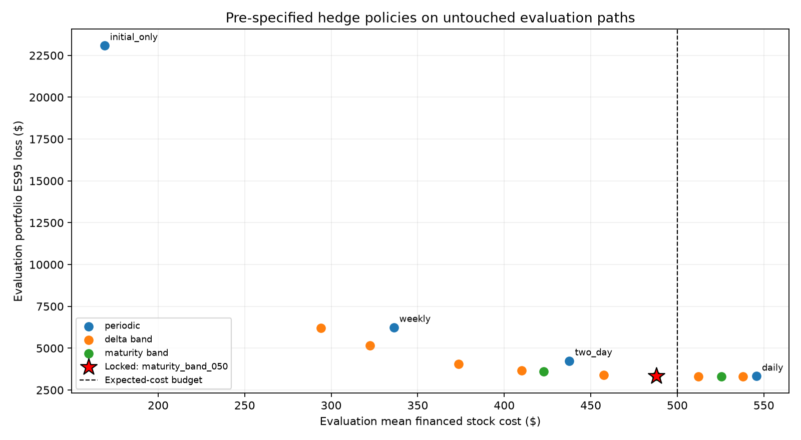
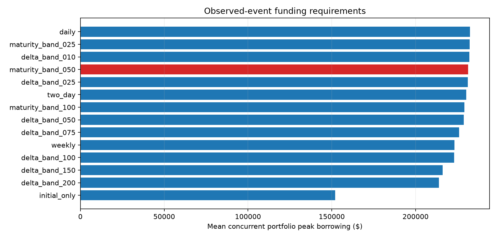

# Research Release 1 — budget-aware hedge selection

Gate status: **complete** for the controlled synthetic study. Human review is a separate next step.

Locked choice: **maturity_band_050**. Objective: minimize selection-sample ES95 subject to a $500 expected financed stock-cost budget.

The book has 3 short synthetic European calls, $300,000 initial underlying notional, 63 trading sessions and a 5bp one-way stock charge.

## Protocol and separation

The fixed 14-policy candidate set was evaluated on 5,000 selection outcomes (seed 730201). selection.json was written and hashed before generating the 10,000 held-out evaluation outcomes (seed 730202). No evaluation-based reselection occurs.

The cost screen uses the upper endpoint of a two-sided 95% normal Monte Carlo interval (a 97.5% one-sided endpoint), not a hard per-path cap or simultaneous guarantee across candidates. Evaluation feasibility is assessed again without changing the locked choice.

The fixed delta band is absolute hedge-share discrepancy divided by option units. The maturity-sensitive band multiplies that threshold by sqrt(remaining maturity / initial maturity). Both open and settle unconditionally.

## Selection results

| policy | loss_es95 | pnl_std | mean_pnl | mean_financed_cost | cost_mean_upper | budget_feasible |
| --- | --- | --- | --- | --- | --- | --- |
| initial_only | 22,363.680 | 8,510.032 | -7.423 | 168.742 | 168.995 | True |
| daily | 3,427.833 | 1,227.109 | -583.527 | 546.794 | 549.965 | False |
| two_day | 4,319.155 | 1,701.216 | -465.579 | 438.194 | 440.782 | True |
| weekly | 6,317.924 | 2,587.241 | -379.752 | 336.774 | 338.845 | True |
| delta_band_010 | 3,421.241 | 1,228.775 | -574.715 | 539.161 | 542.342 | False |
| delta_band_025 | 3,406.259 | 1,249.384 | -548.068 | 513.195 | 516.343 | False |
| delta_band_050 | 3,441.335 | 1,334.665 | -481.563 | 458.560 | 461.516 | True |
| delta_band_075 | 3,599.089 | 1,479.145 | -426.849 | 410.943 | 413.673 | True |
| delta_band_100 | 4,031.128 | 1,721.560 | -380.893 | 373.838 | 376.349 | True |
| delta_band_150 | 5,108.176 | 2,178.522 | -342.778 | 323.106 | 325.284 | True |
| delta_band_200 | 6,212.610 | 2,702.297 | -303.133 | 294.254 | 296.232 | True |
| maturity_band_025 | 3,414.644 | 1,236.243 | -560.738 | 526.496 | 529.683 | False |
| maturity_band_050 | 3,425.938 | 1,278.781 | -517.767 | 489.085 | 492.214 | True |
| maturity_band_100 | 3,526.699 | 1,438.536 | -436.237 | 423.579 | 426.480 | True |

## Untouched evaluation results

| policy | loss_es95 | pnl_std | mean_pnl | mean_financed_cost | cost_mean_upper | budget_feasible |
| --- | --- | --- | --- | --- | --- | --- |
| initial_only | 23,084.459 | 8,582.237 | -150.279 | 168.914 | 169.096 | True |
| daily | 3,326.046 | 1,207.957 | -533.890 | 545.691 | 547.927 | False |
| two_day | 4,242.345 | 1,686.581 | -404.995 | 437.628 | 439.446 | True |
| weekly | 6,242.904 | 2,585.783 | -305.288 | 336.134 | 337.592 | True |
| delta_band_010 | 3,319.230 | 1,209.391 | -525.963 | 538.057 | 540.300 | False |
| delta_band_025 | 3,300.264 | 1,226.598 | -498.454 | 512.082 | 514.299 | False |
| delta_band_050 | 3,390.950 | 1,318.768 | -445.616 | 457.612 | 459.694 | True |
| delta_band_075 | 3,658.863 | 1,484.938 | -391.851 | 410.102 | 412.021 | True |
| delta_band_100 | 4,064.444 | 1,709.134 | -359.671 | 373.545 | 375.317 | True |
| delta_band_150 | 5,166.878 | 2,186.252 | -298.219 | 322.371 | 323.909 | True |
| delta_band_200 | 6,195.217 | 2,695.134 | -266.343 | 293.944 | 295.346 | True |
| maturity_band_025 | 3,309.536 | 1,214.247 | -513.223 | 525.475 | 527.722 | False |
| maturity_band_050 | 3,327.945 | 1,256.802 | -474.640 | 487.971 | 490.177 | True |
| maturity_band_100 | 3,614.180 | 1,458.748 | -410.483 | 422.904 | 424.952 | True |

The locked policy's evaluation budget status is **True**. A false status would be reported as a budget miss, not corrected by switching policies on evaluation data.

## Incremental protection and uncertainty

Each row is ES95(selected) minus ES95(benchmark). Negative values favor the selected rule. Paired bootstrap resamples use common economic-outcome indices and recompute each policy's own worst tail. These are pointwise percentile intervals conditional on the fixed model/policies, not a simultaneous dominance claim or an ES of the P&L difference.

| benchmark | estimate | lower | upper | bootstrap_se |
| --- | --- | --- | --- | --- |
| initial_only | -19,756.514 | -20,479.010 | -19,020.998 | 369.098 |
| daily | 1.899 | -31.614 | 33.564 | 16.861 |
| two_day | -914.401 | -1,013.408 | -809.476 | 53.307 |
| weekly | -2,914.959 | -3,100.693 | -2,710.425 | 98.983 |

Mean net-P&L differences use separate paired mean intervals; negative values mean lower selected-policy average net P&L:

| benchmark | mean_difference | paired_se | mc_95_low | mc_95_high |
| --- | --- | --- | --- | --- |
| initial_only | -324.361 | 84.856 | -490.680 | -158.042 |
| daily | 59.250 | 3.596 | 52.201 | 66.298 |
| two_day | -69.645 | 11.596 | -92.373 | -46.917 |
| weekly | -169.352 | 22.755 | -213.951 | -124.752 |

Selected-policy economic risk intervals:

| metric | estimate | lower | upper | bootstrap_se |
| --- | --- | --- | --- | --- |
| es | 3,327.945 | 3,235.371 | 3,416.628 | 46.023 |
| std | 1,256.802 | 1,237.588 | 1,277.142 | 10.070 |

## Trading and financing

| policy | mean_turnover | mean_trades | mean_peak_borrowing | peak_borrowing_p95 | max_peak_borrowing |
| --- | --- | --- | --- | --- | --- |
| initial_only | 336,149.503 | 6.000 | 152,049.273 | 152,049.273 | 152,049.273 |
| daily | 1,085,974.710 | 190.649 | 232,527.879 | 301,043.065 | 305,716.441 |
| two_day | 870,974.083 | 98.251 | 230,211.086 | 301,432.306 | 307,969.894 |
| weekly | 669,004.629 | 41.890 | 223,290.042 | 301,705.535 | 309,095.318 |
| delta_band_010 | 1,070,782.177 | 142.890 | 232,100.582 | 299,870.196 | 305,665.221 |
| delta_band_025 | 1,019,122.140 | 107.425 | 231,098.238 | 298,241.066 | 304,003.321 |
| delta_band_050 | 910,805.442 | 68.760 | 228,777.276 | 295,728.869 | 302,043.262 |
| delta_band_075 | 816,312.414 | 47.052 | 225,977.324 | 293,052.455 | 300,850.473 |
| delta_band_100 | 743,587.814 | 34.566 | 222,994.144 | 289,989.525 | 301,872.416 |
| delta_band_150 | 641,744.949 | 21.998 | 216,098.112 | 280,503.104 | 306,943.491 |
| delta_band_200 | 585,204.801 | 16.185 | 213,995.272 | 293,018.878 | 304,199.139 |
| maturity_band_025 | 1,045,806.576 | 124.454 | 232,236.749 | 300,865.439 | 305,703.114 |
| maturity_band_050 | 971,296.003 | 89.734 | 231,353.496 | 300,784.012 | 305,754.189 |
| maturity_band_100 | 841,980.231 | 53.788 | 229,131.973 | 300,738.915 | 305,189.752 |

Shared peak funding is the maximum negative aggregate contemporaneous cash, not the sum of separate per-name maxima. The engine observes after interest and after combined trades/costs/settlement; intraday execution order and margin are outside scope.

## Accounting and reproducibility

All candidate ledgers reconcile cash flows, marked value, expiry settlement and the all-outcome financed-cost identity. Pairing verifies fingerprints of the actual stock paths and asset order. protocol.json, selection.json, provenance.json, gate_status.json, CSV tables and selected audit ledgers accompany this report.

## Interpretation and limits

Adaptive rules purchase different residual-risk/cost combinations. Any improvement or inconclusive interval is a valid controlled-study result; the code does not label the largest sample mean an optimal trading strategy. All outputs are conditional on illustrative constant-volatility Q-GBM, zero dividends, common European expiry and simplified stock execution/funding. Sampling intervals omit calibration and model uncertainty. This gate does not establish historical profitability, a market-data gate, a listed-option backtest or stages 3–7.

Historical data, release-aware forecast testing, explicit equity overlays and survivorship-aware breadth are separate evidence requirements. The initial cost budget is an experiment assumption, not an authorization to spend money or trade.
