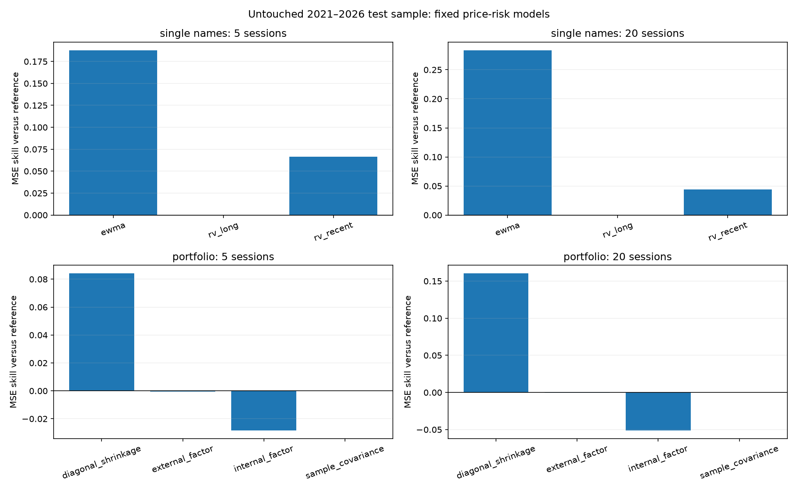
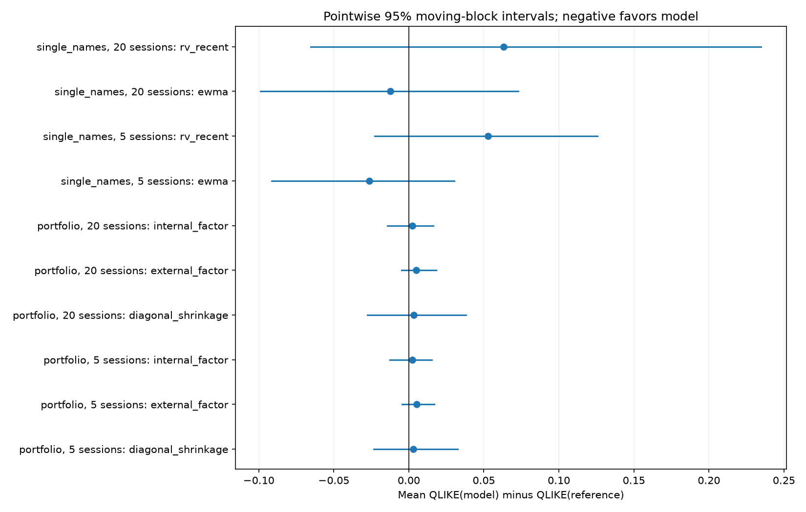

# Price-history risk research — chronological physical-risk forecasts

Universe: JPM, PNC, GS. External factors: SPY, XLF. Input sessions: 4,236, 2010-01-04 through 2026-11-04.

This is a conditional current-name price-risk study, not a survivorship-free universe backtest or a listed-option trading strategy.

Where BK appears, it is a stable study identifier for the issuer whose exchange ticker changed to BNY in 2026. The data audit records the explicit source-symbol mapping and overlap checks; the risk model does not silently fill missing prices.

## Frozen protocol

Training: 2010–2017. Validation: 2018–2020. Untouched test: 2021–2026-11-04. Parameters are fixed before scores are computed; neither validation nor test outcomes tune the windows, EWMA decay, shrinkage or factors. The protocol file is persisted and hashed before evaluation.

Targets are cumulative next-5/20-session squared log returns. All features use information through the origin close only. Evaluation target intervals are disjoint within each split/horizon; cross-asset dependence is preserved by averaging loss differences at each origin before resampling chronological blocks. Circular moving-block lengths approximate one quarter: 13 forecast origins for 5-session targets and 4 for 20-session targets. Intervals are pointwise and do not establish simultaneous superiority.

Price-return histories are split-adjusted and exclude dividend cash flows. They are vendor histories available now, not an archive of every historical data revision. Market and sector factors are observed SPY/XLF price returns from the same past window.

## Models

Company forecasts: rv_long = mean squared returns over 252 sessions; rv_recent =20 sessions; ewma uses lambda 0.94 with 252-session warmup. Each daily variance is multiplied by the horizon, a fixed persistence approximation rather than a fitted term structure.

Portfolio baseline: sample covariance of the past 252 sessions. Alternatives: fixed 20% diagonal shrinkage; an internal equal-weight financial-return factor; and past-only SPY/XLF factor loadings with diagonal residual covariance. Factor loadings and covariance estimates are refreshed using only the window available at each origin. They do not fit on future factor returns.

The portfolio target is squared return risk for a fixed equal-weight linear return basket, not a traded self-financing NAV. Q option valuation and protective-overlay outcomes are separate later tests. Sample covariance is positive semidefinite; diagonal floors stabilize shrinkage and factor estimates.

QLIKE is log(forecast) + realized/forecast, omitting a target-only constant. Lower is better; raw scores may be negative. MSE is squared variance-prediction error. MSE skill above zero improves over the reference; QLIKE differences below zero improve over the reference.

## Untouched test results

| panel | horizon | model | n_dates | mean_qlike | mean_mse | mse_skill_vs_baseline | qlike_difference_vs_baseline |
| --- | --- | --- | --- | --- | --- | --- | --- |
| portfolio | 5 | diagonal_shrinkage | 293 | -5.74439 | 2.42064e-06 | 0.0842894 | 0.00298808 |
| portfolio | 5 | external_factor | 293 | -5.74218 | 2.64506e-06 | -0.000607791 | 0.0051975 |
| portfolio | 5 | internal_factor | 293 | -5.745 | 2.71865e-06 | -0.0284466 | 0.00237436 |
| portfolio | 5 | sample_covariance | 293 | -5.74738 | 2.64346e-06 | 0 | 0 |
| portfolio | 20 | diagonal_shrinkage | 73 | -4.34853 | 2.19127e-05 | 0.160642 | 0.00313485 |
| portfolio | 20 | external_factor | 73 | -4.34659 | 2.6123e-05 | -0.00063467 | 0.0050721 |
| portfolio | 20 | internal_factor | 73 | -4.34935 | 2.74465e-05 | -0.0513314 | 0.0023131 |
| portfolio | 20 | sample_covariance | 73 | -4.35166 | 2.61065e-05 | 0 | 0 |
| single_names | 5 | ewma | 293 | -5.57076 | 2.9828e-06 | 0.187867 | -0.0262789 |
| single_names | 5 | rv_long | 293 | -5.54448 | 3.67279e-06 | 0 | 0 |
| single_names | 5 | rv_recent | 293 | -5.49179 | 3.42803e-06 | 0.0666424 | 0.0526948 |
| single_names | 20 | ewma | 73 | -4.16074 | 2.38178e-05 | 0.283665 | -0.0123854 |
| single_names | 20 | rv_long | 73 | -4.14836 | 3.32496e-05 | 0 | 0 |
| single_names | 20 | rv_recent | 73 | -4.08505 | 3.17914e-05 | 0.043855 | 0.0633041 |

## Dependence-aware uncertainty

| panel | horizon | model | baseline | estimate | lower | upper | n_dates | block_length |
| --- | --- | --- | --- | --- | --- | --- | --- | --- |
| portfolio | 5 | diagonal_shrinkage | sample_covariance | 0.00298808 | -0.0233765 | 0.0327379 | 293 | 13 |
| portfolio | 5 | external_factor | sample_covariance | 0.0051975 | -0.00461542 | 0.0168606 | 293 | 13 |
| portfolio | 5 | internal_factor | sample_covariance | 0.00237436 | -0.0127044 | 0.0154829 | 293 | 13 |
| portfolio | 20 | diagonal_shrinkage | sample_covariance | 0.00313485 | -0.0277735 | 0.0380361 | 73 | 4 |
| portfolio | 20 | external_factor | sample_covariance | 0.0050721 | -0.00472252 | 0.0183451 | 73 | 4 |
| portfolio | 20 | internal_factor | sample_covariance | 0.0023131 | -0.0144252 | 0.0163985 | 73 | 4 |
| single_names | 5 | ewma | rv_long | -0.0262789 | -0.0915267 | 0.0303459 | 293 | 13 |
| single_names | 5 | rv_recent | rv_long | 0.0526948 | -0.0228644 | 0.125823 | 293 | 13 |
| single_names | 20 | ewma | rv_long | -0.0123854 | -0.0987788 | 0.072979 | 73 | 4 |
| single_names | 20 | rv_recent | rv_long | 0.0633041 | -0.0655096 | 0.234875 | 73 | 4 |

The complete CSVs include per-company, pooled and portfolio scores for train, validation and test. Findings are reported as observed, including deterioration or inconclusive intervals; no model is selected post hoc from test outcomes.

## Stage and research gates

Past-only forecasting/covariance implementation and evaluation are complete for the available 3-name sample. This supports the price-history baseline component of stages 4–5. Historical universe membership, liquidity eligibility and survivorship coverage remain unverified, so a wider current-name sample does not by itself complete the generalization gate.

Stage 5 incremental macro, option-implied and company-funding features have not been tested. Release/acceptance timestamps, vintage-aware macro observations and issuer/subsidiary mappings remain outstanding. Forecast improvement has not yet been translated into option-hedging value. Stage 6 equity overlays and the stage 7 untouched-period/composition/realistic-execution gate are not passed by this artifact.

## Checks and provenance

Feature-origin availability and target alignment passed. Minimum observed covariance eigenvalue: 1.4116562e-05. The accompanying tests include future-price perturbation invariance, external-factor availability, PSD, strict next-horizon targets, split boundaries and non-overlap.

protocol.json records input hashes and parameters. manifest.json records source/data/output identities. No credentials are read or stored by this runner.
