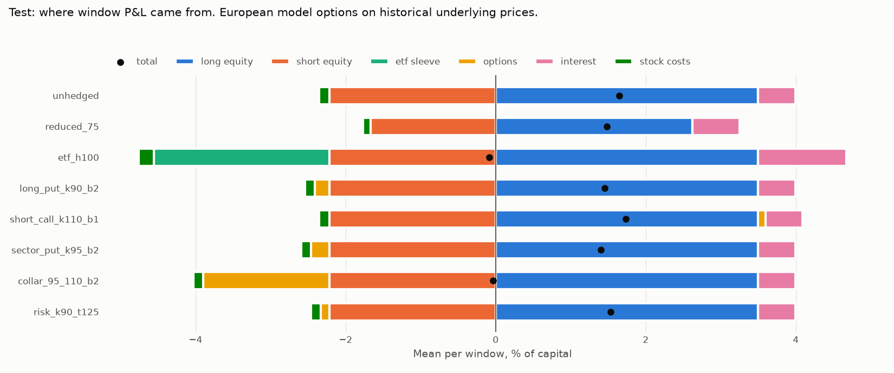
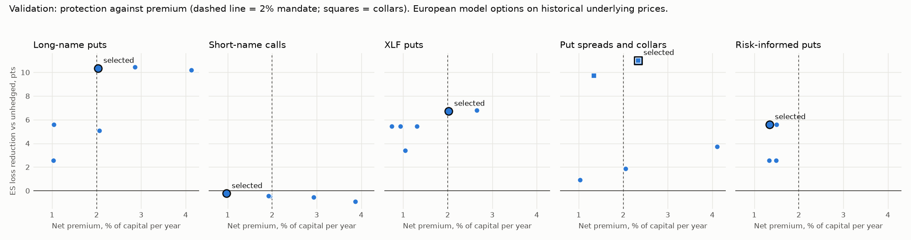
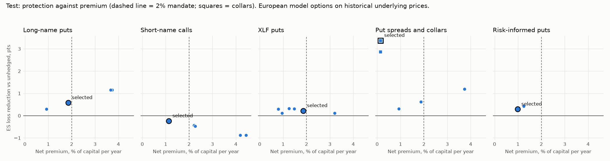
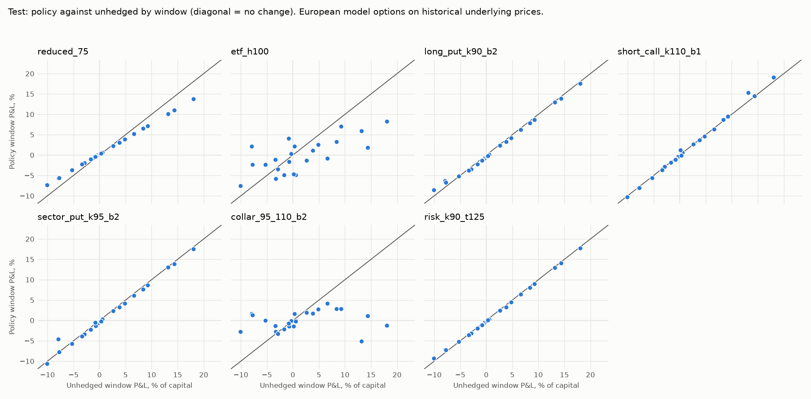
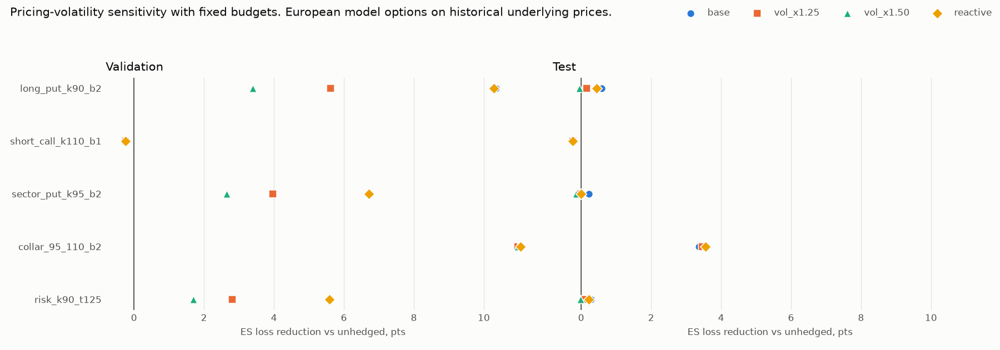

# Stage 6 equity overlays

**European model options on historical underlying prices.** Not listed-option fills and not observed implied volatilities.

The test split was evaluated once, after the protocol hash below was recorded.

Protocol SHA-256: `c66908152994b1e2a611fc7bf0a8c72da332831122f0d3ef61fa798c86df75bd`

## Window counts

| split | windows | first_start | last_end | unused_sessions |
| --- | --- | --- | --- | --- |
| train | 27 | 2011-01-04 | 2017-10-06 | 311 |
| validation | 11 | 2018-01-02 | 2020-10-02 | 62 |
| test | 23 | 2021-01-04 | 2026-10-12 | 17 |

Every window is a separate account opened with the same capital. Nothing here is a chained NAV, CAGR or full-period drawdown.

## Validation selection

| family | selected | validation_es_loss_pct | candidates |
| --- | --- | --- | --- |
| etf_hedge | etf_h100 | 5.383 | 2 |
| long_puts | long_put_k90_b2 | 2.029 | 4 |
| short_calls | short_call_k110_b1 | 12.617 | 4 |
| sector_puts | sector_put_k95_b2 | 5.661 | 4 |
| structures | collar_95_110_b2 | 1.366 | 4 |
| risk_informed | risk_k90_t125 | 6.788 | 4 |

## Test results by window

Values are % of capital per window. Downside capture is policy loss over unhedged loss in windows where the unhedged book lost money, so lower is better. Upside retained is the same ratio in windows where it gained.

| label | n_windows | mean_pnl_pct | worst_pnl_pct | es_loss_pct | worst_max_drawdown_pct | downside_capture | upside_retained |
| --- | --- | --- | --- | --- | --- | --- | --- |
| unhedged | 23 | 1.644 | -10.049 | 6.280 | 15.179 | 1.000 | 1.000 |
| reduced_75 | 23 | 1.484 | -7.286 | 4.458 | 11.165 | 0.687 | 0.787 |
| etf_h100 | 23 | -0.086 | -7.552 | 5.232 | 9.594 | 0.510 | 0.251 |
| long_put_k90_b2 | 23 | 1.451 | -8.517 | 5.700 | 11.836 | 0.979 | 0.934 |
| short_call_k110_b1 | 23 | 1.738 | -10.257 | 6.516 | 15.504 | 1.045 | 1.050 |
| sector_put_k95_b2 | 23 | 1.399 | -10.584 | 6.058 | 13.079 | 1.008 | 0.935 |
| collar_95_110_b2 | 23 | -0.033 | -5.096 | 2.906 | 6.105 | 0.263 | 0.132 |
| risk_k90_t125 | 23 | 1.532 | -9.284 | 5.990 | 13.147 | 0.989 | 0.963 |

## Validation results by window

| label | n_windows | mean_pnl_pct | worst_pnl_pct | es_loss_pct | worst_max_drawdown_pct | downside_capture | upside_retained |
| --- | --- | --- | --- | --- | --- | --- | --- |
| unhedged | 11 | -0.662 | -27.844 | 12.380 | 27.844 | 1.000 | 1.000 |
| reduced_75 | 11 | -0.245 | -20.632 | 9.034 | 20.632 | 0.718 | 0.798 |
| etf_h100 | 11 | -0.272 | -8.484 | 5.383 | 8.508 | 0.249 | 0.212 |
| long_put_k90_b2 | 11 | 2.024 | -2.646 | 2.029 | 18.011 | 0.150 | 0.894 |
| short_call_k110_b1 | 11 | -0.691 | -28.042 | 12.617 | 28.042 | 1.033 | 1.030 |
| sector_put_k95_b2 | 11 | 0.793 | -11.669 | 5.661 | 18.013 | 0.501 | 0.895 |
| collar_95_110_b2 | 11 | 2.147 | -2.617 | 1.366 | 5.756 | -0.327 | 0.349 |
| risk_k90_t125 | 11 | 0.614 | -13.404 | 6.788 | 18.011 | 0.578 | 0.927 |

## Test costs and financing

Annual columns are spending rates in % of capital, not compounded returns.

| label | annual_premium_paid_pct | annual_premium_received_pct | annual_settlement_net_pct | annual_stock_cost_pct | annual_interest_pct | peak_borrowing_pct | peak_funding_ex_short_proceeds_pct |
| --- | --- | --- | --- | --- | --- | --- | --- |
| unhedged | 0.000 | 0.000 | 0.000 | 0.536 | 1.991 | 0.000 | 8.203 |
| reduced_75 | 0.000 | 0.000 | 0.000 | 0.402 | 2.498 | 0.000 | 0.000 |
| etf_h100 | 0.000 | 0.000 | 0.000 | 0.810 | 4.700 | 0.000 | 17.083 |
| long_put_k90_b2 | 1.855 | 0.000 | 1.101 | 0.536 | 1.973 | 0.000 | 8.406 |
| short_call_k110_b1 | 1.131 | 0.000 | 1.516 | 0.536 | 1.980 | 0.000 | 8.859 |
| sector_put_k95_b2 | 1.864 | 0.000 | 0.900 | 0.536 | 1.973 | 0.000 | 8.312 |
| collar_95_110_b2 | 11.532 | 11.387 | -6.565 | 0.536 | 1.990 | 0.000 | 4.400 |
| risk_k90_t125 | 0.990 | 0.000 | 0.550 | 0.536 | 1.981 | 0.000 | 8.406 |

## Realized spend against budget

Budgets are sized at the decision close. Execution is one session later with the strike already fixed, so realized net premium can differ, most of all for a collar, whose cost is a small difference between two premiums. Test first, then validation.

| label | annual_budget_pct | annual_net_premium_pct | worst_window_budget_multiple |
| --- | --- | --- | --- |
| unhedged | 0.000 | 0.000 | n/a |
| reduced_75 | 0.000 | 0.000 | n/a |
| etf_h100 | 0.000 | 0.000 | n/a |
| long_put_k90_b2 | 2.000 | 1.855 | 1.304 |
| short_call_k110_b1 | 1.000 | 1.131 | 2.599 |
| sector_put_k95_b2 | 2.000 | 1.864 | 1.269 |
| collar_95_110_b2 | 2.000 | 0.145 | 4.125 |
| risk_k90_t125 | 1.087 | 0.990 | 1.303 |

| label | annual_budget_pct | annual_net_premium_pct | worst_window_budget_multiple |
| --- | --- | --- | --- |
| unhedged | 0.000 | 0.000 | n/a |
| reduced_75 | 0.000 | 0.000 | n/a |
| etf_h100 | 0.000 | 0.000 | n/a |
| long_put_k90_b2 | 2.000 | 2.031 | 1.316 |
| short_call_k110_b1 | 1.000 | 0.971 | 1.183 |
| sector_put_k95_b2 | 2.000 | 2.022 | 1.419 |
| collar_95_110_b2 | 2.000 | 2.331 | 6.517 |
| risk_k90_t125 | 1.273 | 1.342 | 1.316 |

## Side-specific protection

Whole-book tails fall in sector selloffs, when shorts gain, so they cannot show what a short-side call does. This table uses windows where the protected side lost money. Capture is side loss with the option over side loss without it, so lower is better. Values are % of capital.

| split | label | side | side_loss_windows | windows | mean_side_loss_pct | mean_with_option_pct | worst_side_loss_pct | worst_with_option_pct | side_loss_capture | windows_option_paid |
| --- | --- | --- | --- | --- | --- | --- | --- | --- | --- | --- |
| validation | long_put_k90_b2 | long | 6 | 11 | -11.002 | -5.595 | -41.223 | -12.322 | 0.509 | 5 |
| validation | short_call_k110_b1 | short | 3 | 11 | -8.280 | -7.713 | -10.051 | -9.547 | 0.931 | 3 |
| validation | collar_95_110_b2 | long | 6 | 11 | -11.002 | -2.446 | -41.223 | -4.899 | 0.222 | 6 |
| validation | risk_k90_t125 | long | 6 | 11 | -11.002 | -8.313 | -41.223 | -26.779 | 0.756 | 5 |
| test | long_put_k90_b2 | long | 8 | 23 | -8.026 | -7.703 | -14.574 | -12.965 | 0.960 | 7 |
| test | short_call_k110_b1 | short | 16 | 23 | -4.854 | -4.592 | -11.463 | -9.369 | 0.946 | 14 |
| test | collar_95_110_b2 | long | 8 | 23 | -8.026 | -3.627 | -14.574 | -5.406 | 0.452 | 8 |
| test | risk_k90_t125 | long | 8 | 23 | -8.026 | -7.865 | -14.574 | -13.755 | 0.980 | 7 |

## Test exposure

| label | mean_gross_exposure_pct | mean_net_exposure_pct | mean_etf_exposure_pct | mean_delta_adjusted_net_pct | mean_beta_net_pct | mean_target_coverage |
| --- | --- | --- | --- | --- | --- | --- |
| unhedged | 131.041 | 50.401 | 0.000 | 50.401 | 67.141 | 0.000 |
| reduced_75 | 98.280 | 37.801 | 0.000 | 37.801 | 50.356 | 0.000 |
| etf_h100 | 131.041 | 50.401 | -67.413 | -17.011 | 0.000 | 1.000 |
| long_put_k90_b2 | 131.041 | 50.401 | 0.000 | 45.097 | 67.141 | 0.351 |
| short_call_k110_b1 | 131.041 | 50.401 | 0.000 | 53.564 | 67.141 | 0.250 |
| sector_put_k95_b2 | 131.041 | 50.401 | 0.000 | 42.316 | 67.141 | 0.568 |
| collar_95_110_b2 | 131.041 | 50.401 | 0.000 | -5.385 | 67.141 | 1.000 |
| risk_k90_t125 | 131.041 | 50.401 | 0.000 | 47.577 | 67.141 | 0.189 |

## Test P&L attribution

Mean per window, % of capital.

| label | long_equity | short_equity | etf_sleeve | options | interest | stock_costs | total |
| --- | --- | --- | --- | --- | --- | --- | --- |
| unhedged | 3.499 | -2.219 | 0.000 | 0.000 | 0.498 | -0.134 | 1.644 |
| reduced_75 | 2.624 | -1.664 | 0.000 | 0.000 | 0.625 | -0.100 | 1.484 |
| etf_h100 | 3.499 | -2.219 | -2.339 | 0.000 | 1.175 | -0.202 | -0.086 |
| long_put_k90_b2 | 3.499 | -2.219 | 0.000 | -0.188 | 0.493 | -0.134 | 1.451 |
| short_call_k110_b1 | 3.499 | -2.219 | 0.000 | 0.096 | 0.495 | -0.134 | 1.738 |
| sector_put_k95_b2 | 3.499 | -2.219 | 0.000 | -0.241 | 0.493 | -0.134 | 1.399 |
| collar_95_110_b2 | 3.499 | -2.219 | 0.000 | -1.677 | 0.497 | -0.134 | -0.033 |
| risk_k90_t125 | 3.499 | -2.219 | 0.000 | -0.110 | 0.495 | -0.134 | 1.532 |

## Frontiers

Unselected test grid points are descriptive. None was chosen using test outcomes.

## Dependence-aware uncertainty

Differences against unhedged use a circular block bootstrap over chronological windows, with issuers aggregated inside each window. Negative ES differences favor the policy. Intervals are pointwise. The ex-best column repeats the mean difference without the single most favorable window, which shows how far a result rests on one episode.

| split | label | n_windows | block_windows | tail_windows | mean_difference_pct | mean_lower_pct | mean_upper_pct | mean_ex_best_window_pct | best_window_key | es_difference_pct | es_lower_pct | es_upper_pct | evidence |
| --- | --- | --- | --- | --- | --- | --- | --- | --- | --- | --- | --- | --- | --- |
| validation | reduced_75 | 11 | 4 | 3 | 0.417 | -0.564 | 1.383 | -0.263 | validation-008 | -3.346 | -7.212 | -0.710 | exploratory |
| validation | etf_h100 | 11 | 4 | 3 | 0.390 | -1.907 | 2.554 | -1.507 | validation-008 | -6.997 | -19.360 | 0.502 | exploratory |
| validation | long_put_k90_b2 | 11 | 4 | 3 | 2.686 | -0.298 | 7.507 | 0.065 | validation-008 | -10.351 | -26.642 | -0.127 | exploratory |
| validation | short_call_k110_b1 | 11 | 4 | 3 | -0.029 | -0.227 | 0.217 | -0.146 | validation-007 | 0.236 | 0.197 | 0.271 | exploratory |
| validation | sector_put_k95_b2 | 11 | 4 | 3 | 1.455 | -0.448 | 4.050 | -0.017 | validation-008 | -6.720 | -16.175 | 0.337 | exploratory |
| validation | collar_95_110_b2 | 11 | 4 | 3 | 2.809 | -0.999 | 6.827 | -0.606 | validation-008 | -11.014 | -25.227 | -0.769 | exploratory |
| validation | risk_k90_t125 | 11 | 4 | 3 | 1.276 | -0.214 | 3.690 | -0.040 | validation-008 | -5.592 | -14.440 | -0.095 | exploratory |
| test | reduced_75 | 23 | 4 | 6 | -0.160 | -0.807 | 0.543 | -0.293 | test-016 | -1.821 | -2.381 | -0.922 | exploratory |
| test | etf_h100 | 23 | 4 | 6 | -1.731 | -3.713 | 0.311 | -2.270 | test-005 | -1.048 | -3.523 | 2.158 | exploratory |
| test | long_put_k90_b2 | 23 | 4 | 6 | -0.193 | -0.421 | 0.060 | -0.276 | test-005 | -0.580 | -1.346 | 0.247 | exploratory |
| test | short_call_k110_b1 | 23 | 4 | 6 | 0.093 | -0.091 | 0.312 | 0.003 | test-017 | 0.237 | 0.150 | 0.286 | exploratory |
| test | sector_put_k95_b2 | 23 | 4 | 6 | -0.246 | -0.466 | 0.090 | -0.406 | test-005 | -0.222 | -1.420 | 0.524 | exploratory |
| test | collar_95_110_b2 | 23 | 4 | 6 | -1.678 | -4.270 | 1.113 | -2.186 | test-005 | -3.373 | -5.253 | -0.161 | exploratory |
| test | risk_k90_t125 | 23 | 4 | 6 | -0.112 | -0.226 | 0.014 | -0.155 | test-005 | -0.290 | -0.680 | 0.123 | exploratory |

## Tail episodes

Adjacent tail windows are merged, because one crisis can span windows.

| split | episode | windows | start | end | worst_pnl_pct |
| --- | --- | --- | --- | --- | --- |
| train | 1 | 2 | 2011-04-05 | 2011-10-04 | -10.816 |
| train | 2 | 1 | 2012-04-04 | 2012-07-05 | -2.874 |
| train | 3 | 1 | 2013-07-09 | 2013-10-07 | -3.009 |
| train | 4 | 2 | 2014-04-08 | 2014-10-07 | -1.637 |
| train | 5 | 1 | 2016-01-07 | 2016-04-08 | -3.284 |
| validation | 1 | 1 | 2018-01-02 | 2018-04-04 | -2.164 |
| validation | 2 | 1 | 2018-10-02 | 2019-01-03 | -7.133 |
| validation | 3 | 1 | 2020-01-03 | 2020-04-03 | -27.844 |
| test | 1 | 3 | 2021-10-04 | 2022-07-06 | -7.930 |
| test | 2 | 1 | 2023-01-04 | 2023-04-05 | -7.776 |
| test | 3 | 1 | 2023-07-07 | 2023-10-05 | -3.341 |
| test | 4 | 1 | 2025-01-07 | 2025-04-09 | -10.049 |

## Pricing and design sensitivity

ES loss reduction against unhedged, in points. Budgets stay fixed, so dearer options buy less coverage.

| split | label | base | rate_0.00 | reactive | vol_x1.25 | vol_x1.50 | window_21 |
| --- | --- | --- | --- | --- | --- | --- | --- |
| test | collar_95_110_b2 | 3.373 | 2.393 | 3.558 | 3.462 | 3.557 | 0.861 |
| test | long_put_k90_b2 | 0.580 | 0.456 | 0.437 | 0.156 | -0.041 | 0.693 |
| test | risk_k90_t125 | 0.290 | 0.228 | 0.218 | 0.078 | -0.020 | 0.349 |
| test | sector_put_k95_b2 | 0.222 | 0.119 | 0.005 | -0.024 | -0.149 | 0.249 |
| test | short_call_k110_b1 | -0.237 | -0.232 | -0.238 | -0.242 | -0.244 | -0.085 |
| validation | collar_95_110_b2 | 11.014 | 9.296 | 11.051 | 10.974 | 10.975 | 2.342 |
| validation | long_put_k90_b2 | 10.351 | 9.136 | 10.294 | 5.612 | 3.402 | 3.063 |
| validation | risk_k90_t125 | 5.592 | 4.567 | 5.588 | 2.804 | 1.699 | 3.048 |
| validation | sector_put_k95_b2 | 6.720 | 5.350 | 6.720 | 3.968 | 2.649 | 1.768 |
| validation | short_call_k110_b1 | -0.236 | -0.233 | -0.236 | -0.239 | -0.241 | -0.099 |

## Sector basis

An XLF put pays on sector moves. It does not pay for an issuer-specific loss, and it does not protect short positions against a rally. The ten worst test windows for the book are below, in % of capital.

| key | split | start | end | book_pnl_pct | long_equity_pnl_pct | short_equity_pnl_pct | sector_option_pnl_pct | name_option_pnl_pct |
| --- | --- | --- | --- | --- | --- | --- | --- | --- |
| test-016 | test | 2025-01-07 | 2025-04-09 | -10.049 | -12.103 | 1.684 | -0.529 | 1.537 |
| test-005 | test | 2022-04-04 | 2022-07-06 | -7.930 | -14.574 | 6.264 | 3.299 | 1.638 |
| test-008 | test | 2023-01-04 | 2023-04-05 | -7.776 | -13.987 | 5.847 | 0.051 | 1.022 |
| test-004 | test | 2022-01-03 | 2022-04-04 | -5.265 | -10.647 | 5.031 | -0.404 | 0.115 |
| test-010 | test | 2023-07-07 | 2023-10-05 | -3.341 | -6.004 | 2.292 | -0.489 | -0.366 |
| test-003 | test | 2021-10-04 | 2022-01-03 | -3.316 | -0.063 | -3.617 | -0.568 | -0.440 |
| test-006 | test | 2022-07-06 | 2022-10-04 | -2.874 | 0.548 | -3.796 | -0.518 | -0.547 |
| test-001 | test | 2021-04-06 | 2021-07-06 | -1.708 | 1.534 | -3.613 | -0.509 | -0.505 |
| test-020 | test | 2026-01-09 | 2026-04-13 | -0.831 | -1.492 | 0.287 | 0.356 | -0.507 |
| test-018 | test | 2025-07-11 | 2025-10-09 | -0.730 | 2.554 | -3.654 | -0.586 | -0.522 |

## Hand reconciliation

Hand values are rebuilt from raw closes with an erf-based option formula, then compared with the replay ledger.

| case | stage | item | hand | ledger | residual |
| --- | --- | --- | --- | --- | --- |
| validation_long_downside | inception | stock cash flow | -49,361,636.26 | -49,361,636.26 | 0.00 |
| validation_long_downside | inception | option premium cash flow | -658,042.98 | -658,042.98 | -0.00 |
| validation_long_downside | inception | stock cost | 64,021.60 | 64,021.60 | 0.00 |
| validation_long_downside | inception | cash | 49,916,299.17 | 49,916,299.17 | 0.00 |
| validation_long_downside | inception | nav | 99,935,978.40 | 99,935,978.40 | 0.00 |
| validation_long_downside | adverse 2020-01-31 | cash | 50,067,067.62 | 50,067,067.62 | 0.00 |
| validation_long_downside | adverse 2020-01-31 | stock value | 43,681,428.55 | 43,681,428.55 | 0.00 |
| validation_long_downside | adverse 2020-01-31 | option value | 1,843,929.68 | 1,843,929.68 | -0.00 |
| validation_long_downside | adverse 2020-01-31 | nav | 95,592,425.85 | 95,592,425.85 | 0.00 |
| validation_long_downside | expiry | option settlement | 29,558,854.50 | 29,558,854.50 | 0.00 |
| validation_long_downside | expiry | stock proceeds | 21,110,136.63 | 21,110,136.63 | 0.00 |
| validation_long_downside | expiry | stock cost | 36,924.65 | 36,924.65 | -0.00 |
| validation_long_downside | expiry | terminal nav | 101,050,032.79 | 101,050,032.79 | 0.00 |
| validation_long_downside | expiry | total interest | 501,667.15 | 501,667.15 | -0.00 |
| validation_long_downside | roll | next window opens with common capital, not prior NAV | 100,000,000.00 | 100,000,000.00 | 0.00 |
| validation_short_upside | inception | stock cash flow | -46,618,657.44 | -46,618,657.44 | -0.00 |
| validation_short_upside | inception | option premium cash flow | -231,941.79 | -231,941.79 | 0.00 |
| validation_short_upside | inception | stock cost | 62,897.33 | 62,897.33 | -0.00 |
| validation_short_upside | inception | cash | 53,086,503.44 | 53,086,503.44 | -0.00 |
| validation_short_upside | inception | nav | 99,937,102.67 | 99,937,102.67 | 0.00 |
| validation_short_upside | adverse 2020-05-13 | cash | 53,314,505.25 | 53,314,505.25 | -0.00 |
| validation_short_upside | adverse 2020-05-13 | stock value | 45,417,242.53 | 45,417,242.53 | 0.00 |
| validation_short_upside | adverse 2020-05-13 | option value | 250,501.08 | 250,501.08 | 0.00 |
| validation_short_upside | adverse 2020-05-13 | nav | 98,982,248.86 | 98,982,248.86 | 0.00 |
| validation_short_upside | expiry | option settlement | 735,223.90 | 735,223.90 | 0.00 |
| validation_short_upside | expiry | stock proceeds | 51,812,572.31 | 51,812,572.31 | -0.00 |
| validation_short_upside | expiry | stock cost | 75,544.96 | 75,544.96 | 0.00 |
| validation_short_upside | expiry | terminal nav | 106,092,282.92 | 106,092,282.92 | 0.00 |
| validation_short_upside | expiry | total interest | 533,528.23 | 533,528.23 | -0.00 |
| validation_short_upside | roll | next window opens with common capital, not prior NAV | 100,000,000.00 | 100,000,000.00 | 0.00 |
| test_long_downside | inception | stock cash flow | -50,332,660.34 | -50,332,660.34 | 0.00 |
| test_long_downside | inception | option premium cash flow | -492,647.90 | -492,647.90 | -0.00 |
| test_long_downside | inception | stock cost | 65,002.12 | 65,002.12 | 0.00 |
| test_long_downside | inception | cash | 49,109,689.63 | 49,109,689.63 | -0.00 |
| test_long_downside | inception | nav | 99,934,997.88 | 99,934,997.88 | 0.00 |
| test_long_downside | adverse 2022-06-30 | cash | 49,579,635.24 | 49,579,635.24 | 0.00 |
| test_long_downside | adverse 2022-06-30 | stock value | 41,523,483.16 | 41,523,483.16 | -0.00 |
| test_long_downside | adverse 2022-06-30 | option value | 2,281,850.98 | 2,281,850.98 | 0.00 |
| test_long_downside | adverse 2022-06-30 | nav | 93,384,969.39 | 93,384,969.39 | 0.00 |
| test_long_downside | expiry | option settlement | 2,130,700.50 | 2,130,700.50 | 0.00 |
| test_long_downside | expiry | stock proceeds | 42,023,398.61 | 42,023,398.61 | 0.00 |
| test_long_downside | expiry | stock cost | 54,583.13 | 54,583.13 | 0.00 |
| test_long_downside | expiry | terminal nav | 93,702,766.20 | 93,702,766.20 | 0.00 |
| test_long_downside | expiry | total interest | 493,560.59 | 493,560.59 | -0.00 |
| test_long_downside | roll | next window opens with common capital, not prior NAV | 100,000,000.00 | 100,000,000.00 | 0.00 |
| test_short_upside | inception | stock cash flow | -52,885,573.51 | -52,885,573.51 | 0.00 |
| test_short_upside | inception | option premium cash flow | -649,742.44 | -649,742.44 | 0.00 |
| test_short_upside | inception | stock cost | 70,316.76 | 70,316.76 | -0.00 |
| test_short_upside | inception | cash | 46,394,367.29 | 46,394,367.29 | 0.00 |
| test_short_upside | inception | nav | 99,929,683.24 | 99,929,683.24 | 0.00 |
| test_short_upside | adverse 2025-04-10 | cash | 46,401,732.06 | 46,401,732.06 | 0.00 |
| test_short_upside | adverse 2025-04-10 | stock value | 50,413,388.97 | 50,413,388.97 | 0.00 |
| test_short_upside | adverse 2025-04-10 | option value | 442,219.65 | 442,219.65 | -0.00 |
| test_short_upside | adverse 2025-04-10 | nav | 97,257,340.67 | 97,257,340.67 | 0.00 |
| test_short_upside | expiry | option settlement | 2,744,398.00 | 2,744,398.00 | 0.00 |
| test_short_upside | expiry | stock proceeds | 65,754,726.83 | 65,754,726.83 | 0.00 |
| test_short_upside | expiry | stock cost | 88,214.84 | 88,214.84 | 0.00 |
| test_short_upside | expiry | terminal nav | 115,271,548.43 | 115,271,548.43 | 0.00 |
| test_short_upside | expiry | total interest | 466,271.14 | 466,271.14 | -0.00 |
| test_short_upside | roll | next window opens with common capital, not prior NAV | 100,000,000.00 | 100,000,000.00 | 0.00 |

## Gates

| gate | status | evidence |
| --- | --- | --- |
| Fixed 6-10-name long/short book | passed | 10 names, gross and net validated against issuer weights |
| Calendar and coverage alignment | passed | 4236 sessions, exchange calendar match: True |
| Protocol frozen and hashed before test | passed | Selection saw prices through 2020-12-31 |
| Test evaluated once with no later changes | passed | 1 logged attempt(s), changed files: [] |
| Model-contract accounting | passed | All window checks true: True; largest hand residual $1.49e-08 |
| All eight comparisons evaluated | passed | Test families evaluated: 8; missing: [] |
| Statistical evidence of protection | exploratory | 23 test windows and 6 tail windows |
| Continuous rolled portfolio NAV | not_available | replay opens all options at inception; separate windows only |
| Listed-option execution backtest | blocked | No verified historical option quotes; results are model contracts only |
| Dividends, borrow, margin, option spreads, American exercise | not_modeled | Not supported by replay or the price inputs |
| Survivorship-safe generalization | blocked | Historical membership access denied; current survivors only |

## Disclosures

- The first and last rows of the price panels were displayed before the book was fixed, so 2010 and 2026 price levels were visible. The book therefore holds all ten panel names and assigns side by a business-line rule.
- The author has general knowledge of market history after 2020, so the test period is untouched by this protocol but is not unknown history.
- The data integrity audit reported only aggregate pass or fail counts for sessions after 2020.
- Training and validation outputs could be inspected before freezing. The test split was not evaluated before the protocol hash was recorded.
- Freezes equity-overlays-20261106T020955456052Z and equity-overlays-20261106T021350045727Z were superseded before any test evaluation. Inspecting validation output prompted three reporting additions: realized spend against budget, side-specific protection, and results excluding the best window. A hard-coded gate was also replaced by a computed one. No decision rule, candidate or selection changed.
- Validation holds 11 windows because a twelfth misses the split end by one session. The frozen rule drops it, and it was left dropped after validation output was seen.

## Limitations

- No historical option quotes or observed implied volatilities. Option prices are Black-Scholes values at an assumed volatility with no skew or term structure.
- No option bid/ask charge, because replay has no option execution cost. Purchased protection is therefore flattered.
- European cash settlement only. Listed single-name options are American and physically settled.
- Split-adjusted closes are not total returns. Dividends received on longs, owed on shorts and owed on a short ETF are excluded, and the option model has no dividend yield.
- No stock borrow fee, short rebate spread or margin requirement. Short proceeds earn the full constant rate.
- The rate is a constant illustrative 4%, including years when short rates were near zero.
- Issuers are current survivors. Historical membership is unavailable, so failed and acquired banks are absent.
- Each window is a separate account that buys and liquidates the whole book, which overstates stock turnover against a rolled book.
- Holdings are not rebalanced inside a window, so exposure drifts from target.
- Window results are not a continuously funded portfolio. No NAV path, CAGR or full-period drawdown is reported.
